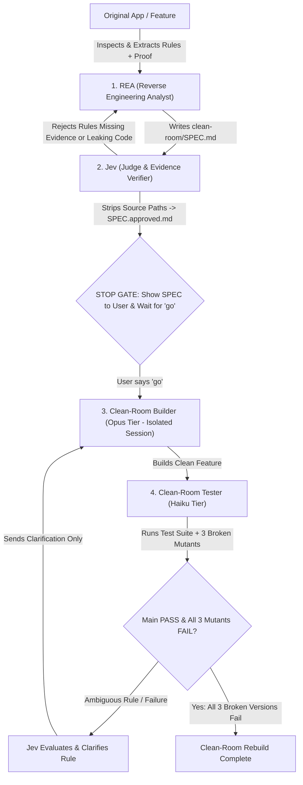

# Clean-Room Rebuild Architecture (REA + Jev + Builder + 3-Mutant Tester)

## The Clean-Room Iron Law

> **The model that sees the original NEVER writes code, and the model that writes code NEVER sees the original.**

Nothing is copied and zero guesswork enters the codebase because the Builder never sees the original source—only proven, sanitized behavioral rules verified by **Jev**.

## Architecture & Agent Roles

## Step-by-Step Execution Protocol

### Phase 1: REA Extraction (`rea` subagent)
1. Create directory `clean-room/` in the workspace.
2. Invoke the `rea` subagent to investigate `[FEATURE]` in `[APP]`.
3. `rea` writes every behavior, edge case, state transition, and invariant into `clean-room/SPEC.md`.
4. Every `RULE-XXX` in `clean-room/SPEC.md` MUST carry concrete evidence (`Source` + `Proof`) from the original app and zero copied implementation code.

### Phase 2: Jev Evidence Audit (`jev` subagent)
1. Invoke the `jev` subagent to audit `clean-room/SPEC.md` rule by rule.
2. Any rule lacking hard evidence, containing guesswork, or leaking internal implementation details is marked `REJECTED` in `clean-room/jev-audit.md` and sent back to `rea`.
3. Loop between `rea` and `jev` until **100% of rules are `APPROVED`**.
4. `jev` produces `clean-room/SPEC.approved.md` (with original source file paths stripped so the Builder remains 100% blind to the original code structure).

### Phase 3: Mandatory Human Gate ("go")
1. Present `clean-room/SPEC.md` (and `clean-room/SPEC.approved.md` summary) to the user.
2. **HARD STOP**: Do NOT write any implementation code or spawn the Builder until the user explicitly replies **`"go"`**.

### Phase 4: Clean-Room Rebuild (`clean-room-builder` on Opus Tier)
Once the user says `"go"`:
1. Spawn a fresh, isolated `clean-room-builder` subagent (using Opus / highest reasoning tier) with **ONLY** `clean-room/SPEC.approved.md` and target output path.
2. The Builder is strictly forbidden from opening or searching the original `[APP]` source files.
3. The Builder implements the feature from scratch following `clean-room/SPEC.approved.md`.

### Phase 5: Haiku Test Suite + 3 Broken Versions (`clean-room-tester` + `/goal` Loop)
1. Spawn `clean-room-tester` (using Haiku / fast tier) to:
   - Write automated tests for every rule in `clean-room/SPEC.approved.md`.
   - Create **3 broken mutant versions** of the new implementation in `clean-room/mutants/`:
     - `mutant-1`: Boundary / off-by-one sabotage.
     - `mutant-2`: Invariant / guard bypass sabotage.
     - `mutant-3`: Error-handling / edge-case sabotage.
2. Run the verification loop (compatible with `/goal`):
   - If the Main Build fails a test or a rule is ambiguous, `jev` inspects the failure and passes a clean black-box rule clarification back to `clean-room-builder` (Opus).
   - If any of the 3 broken versions **passes** the test suite (mutant survives), `clean-room-tester` strengthens the test assertions until the mutant is killed.
   - Continue until **Main Build = 100% PASS** AND **all 3 broken versions FAIL**.
